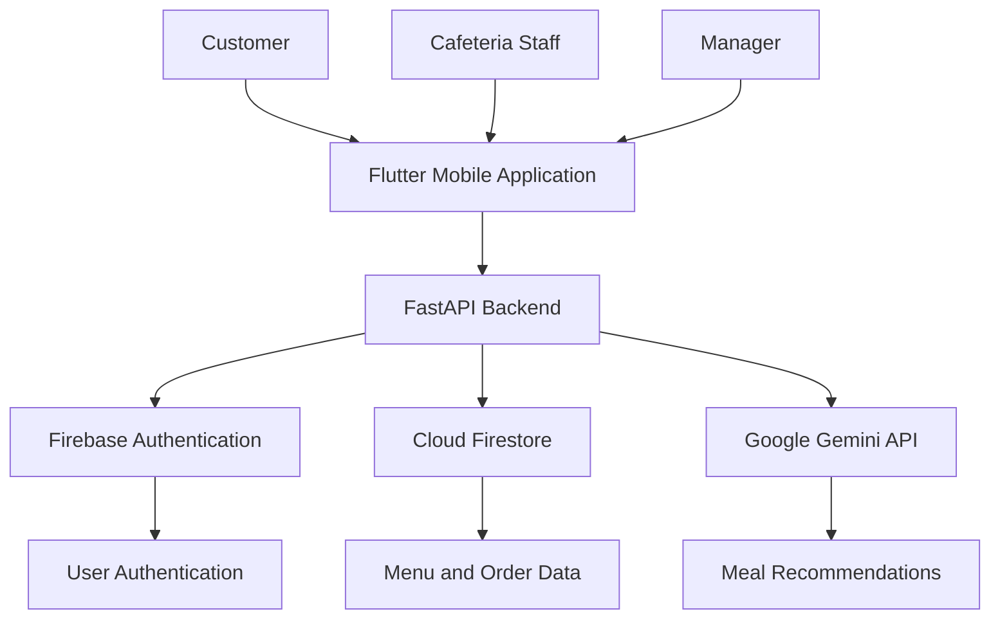

# 🍽️ Smart Integrated Cafeteria Menu and Order Management System

A smart, mobile-based cafeteria management system designed to simplify food ordering, reduce waiting times, and improve cafeteria operations through digital ordering, real-time order management, QR-based pickup verification, and AI-powered meal recommendations.

---


## 📖 About the Project

The **Smart Integrated Cafeteria Menu and Order Management System** is a mobile application developed to modernize traditional cafeteria operations.

The system provides a centralized platform where customers can browse available meals, place orders in advance, monitor order progress, and receive personalized meal recommendations.

At the same time, cafeteria staff can manage incoming orders, update preparation statuses, and verify customer pickups using QR codes. Managers can oversee menu items and their availability.

The project aims to create a more convenient, organized, and efficient cafeteria experience for customers, staff, and management.

## ⚠️ Problem Statement

Traditional cafeteria operations often involve several challenges:

- Long queues and unnecessary waiting times.
- Difficulty knowing which meals are currently available.
- Manual order handling and communication.
- Limited visibility into order preparation progress.
- Inefficient order pickup and verification.
- Lack of personalized meal recommendations.

This project addresses these challenges through an integrated digital platform.

## 🎯 Project Objectives

- Develop a user-friendly mobile cafeteria application.
- Allow customers to browse menus and place advance orders.
- Improve communication between customers and cafeteria staff.
- Provide order tracking and estimated waiting times.
- Introduce QR-based pickup verification.
- Provide AI-powered meal recommendations.
- Simplify menu and availability management for cafeteria managers.

## ✨ Key Features

### 👤 Customer Features

- User registration and login.
- Browse daily cafeteria menus.
- View meal details and availability.
- Add meals to a shopping cart.
- Place advance orders.
- Track order preparation status.
- View estimated waiting times.
- Receive AI-powered meal recommendations.

### 👨‍🍳 Staff Features

- View incoming customer orders.
- Manage order preparation.
- Update order statuses.
- Scan QR codes to verify customer pickups.

### 🧑‍💼 Manager Features

- Access the manager dashboard.
- Manage cafeteria menu items.
- Update meal availability.
- Monitor cafeteria operations.

### 🤖 AI-Powered Recommendations

The system plans to integrate the Google Gemini API to provide meal recommendations based on customer preferences.

This feature aims to help customers discover meals that better match their interests.

## 🛠️ Technology Stack

| Technology | Purpose |
|---|---|
| Flutter | Cross-platform mobile application development |
| Dart | Application programming language |
| Riverpod | State management |
| GoRouter | Application navigation |
| FastAPI | Planned backend API |
| Firebase Authentication | Planned user authentication |
| Cloud Firestore | Planned database |
| Google Gemini API | AI-powered meal recommendations |

**Note:** Some technologies represent the planned project architecture and may not yet be fully integrated.

## 🏗️ System Architecture

The planned system follows a client-server architecture.



## 📂 Project Structure

The Flutter application follows a feature-based architecture to keep the code organized, modular, and maintainable.

```text
cafeteria_menu/
│
├── android/
├── ios/
├── linux/
├── macos/
├── web/
├── windows/
│
├── lib/
│   ├── main.dart
│   │
│   ├── core/
│   │   ├── router/
│   │   │   └── app_router.dart
│   │   ├── theme/
│   │   │   └── app_theme.dart
│   │   └── widgets/
│   │       ├── app_bottom_nav.dart
│   │       └── placeholder_screen.dart
│   │
│   └── features/
│       ├── auth/
│       ├── menu/
│       ├── cart/
│       ├── orders/
│       ├── staff/
│       ├── manager/
│       ├── qr_scanner/
│       └── recommendations/
│
├── test/
│   ├── navigation_test.dart
│   └── widget_test.dart
│
├── labs/
├── PROPOSAL.md
├── project.yaml
├── pubspec.yaml
├── analysis_options.yaml
└── README.md
```

## 🚀 Getting Started

### Prerequisites

Before running the application, make sure you have installed:

- [Flutter SDK](https://docs.flutter.dev/get-started/install)
- [Dart SDK](https://dart.dev/get-dart)
- [Git](https://git-scm.com/)
- [Android Studio](https://developer.android.com/studio) or [Visual Studio Code](https://code.visualstudio.com/)

Verify your Flutter installation:

```bash
flutter doctor
```

### Installation

**1. Clone the repository**

```bash
git clone YOUR_REPOSITORY_URL
```

**2. Navigate into the project directory**

```bash
cd cafeteria_menu
```

**3. Install dependencies**

```bash
flutter pub get
```

## ▶️ Running the Application

Connect an Android device or start an emulator.

Run:

```bash
flutter run
```

To list available devices:

```bash
flutter devices
```

## 🧪 Testing

Run static code analysis:

```bash
flutter analyze
```

Run the automated tests:

```bash
flutter test
```

## 👥 Development Team

This project is developed collaboratively by four Computer Science students.

| Team Member | Responsibility |
|---|---|
| **Simret Yitbarek** | Core Architecture, Navigation and Application Integration |
| **Meresiet Zekiros** | Customer-Facing Interface |
| **Tinsae Ayshesim** | Models, Repositories, Database Logic and State Management |
| **Yared Gebre** | Staff and Manager Dashboards, QR Scanner and AI Recommendations |

## 📊 Project Status

The project is being developed incrementally.


## 🎓 Academic Project

Developed as a collaborative university software engineering project.

**Project Name:** Smart Integrated Cafeteria Menu and Order Management System

**Platform:** Flutter Mobile Application


